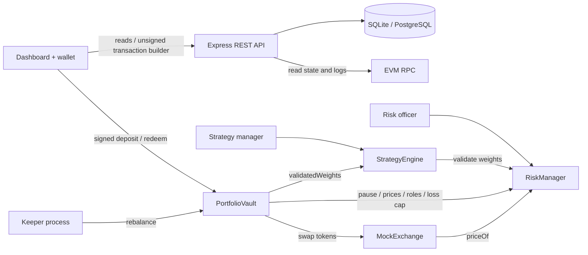

# AlphaVault

**Decentralized Quantitative Portfolio Management and Risk-Controlled Rebalancing Platform**  
SC6113 · individual implementation · runnable research MVP

AlphaVault holds three test tokens in a shared vault, issues nontransferable shares, computes portfolio weights from three strategies, and executes token swaps only when a separate risk contract approves the target. A Node.js REST API indexes the actual EVM state into SQLite locally or PostgreSQL on free hosting. The browser supports both a local role-switching demonstration and externally signed wallet transactions.

## Quick start

Requires **Node.js 22.13 or newer** (tested with 22.23.2), npm, and free TCP ports 3100 and 18547. Node 20 cannot run the built-in SQLite module.

```sh
npm ci
npm run compile
npm test
npm run dev
```

Open **http://127.0.0.1:3100**. The command creates a persistent local Ganache chain and SQLite database under `data/local`, deploys all contracts, funds mock exchange liquidity, and deposits 10,000 mUSD for the demo investor. The initial allocation is all cash; choose the Keeper role and execute the first rebalance in **Strategies**.

```sh
# Run the automatic Keeper in the same local process.
AUTO_KEEPER=1 npm run dev
# Optional independent ports / separate demonstration data.
PORT=3200 RPC_PORT=18548 DATA_DIR=./data/demo-2 npm run dev
```

Restarting preserves the same chain, contracts, balances and SQLite data. To create a new demonstration without touching the existing one, use a new `DATA_DIR`. The known local test mnemonic is `test test test test test test test test test test test junk`. Never use those accounts outside disposable local tests. RPC binds only to loopback. Existing escrow project files, ports, deployments and credentials are not reused.

The local demo bar lets you act as Investor, Strategy manager, Risk officer, Keeper or Admin. A role switch does not grant real permissions: the backend selects a different local test signer, and the contracts enforce access. The normal hosted server disables this signing endpoint entirely.

## What is implemented

- `PortfolioVault`: mUSD deposits, NAV-based share issuance, minimum-share protection, pro-rata **in-kind** redemption, reentrancy lock, automated execution flag, cooldown, deadline and aggregate execution-loss checks.
- `StrategyEngine`: equal-weight risky allocation, momentum tilt, volatility targeting, strategy selection/enablement and parameter updates.
- `RiskManager`: independent permissions, asset enablement, oracle freshness, maximum target weight, minimum cash, weighted-volatility bound, execution-loss cap and pause.
- `MockExchange` and three `MockERC20` instances: real test-token transfers at manually reported prices with a 20 bp fee on each swap. These are simulation infrastructure, not a live DEX.
- REST API, persistent SQLite/PostgreSQL records, incremental event indexing, chain-rollback detection, snapshots, prices, strategies, Keeper jobs and synthetic backtest results.
- Dashboard with holdings, allocation, observed share-value history, role actions, transaction confirmations, risk controls, strategy research and exportable event ledger.
- An off-chain Keeper checks drift and eligibility every 10 seconds. Automation needs a running process; a smart contract does not execute itself.
- Reproducible synthetic backtests with lagged 20-day signals, weekly trading and explicit costs; no live performance claims.

## Architecture



The three required core contracts genuinely interact in the execution path: **Vault → StrategyEngine → RiskManager**, with additional direct Vault → RiskManager calls. Mock tokens and the mock venue are supplementary infrastructure.

## Demonstrate in five minutes

1. Start `npm run dev`, inspect Overview, then select **Keeper → Strategies → Execute rebalance**. Observe token holdings and the 20 bp buy fees.
2. Select **Strategy manager**, choose Momentum or Volatility Target, inspect target weights. The Keeper can execute again after the 60-second minimum interval.
3. Select **Investor**, approve 1,000 mUSD, then deposit. Shares are priced from pre-deposit NAV. Redeem 25% to receive a proportional basket.
4. Select **Risk officer**, pause the vault. Deposits and trading fail; Investor redemption still succeeds. Resume afterward.
5. Lower the position cap below the selected target, or disable an asset. Inspect the rejected policy. Restore limits before continuing.
6. Open Activity ledger and export the indexed events. Evaluate a strategy using the clearly labelled synthetic research fixture.

Prices expire after one hour by default. Refresh both risky assets using Risk controls → Mock market report. This is a deliberate stale-price guard, not a broken UI. On a restarted older chain the dashboard displays last-reported valuations with a stale warning; deposits into invested portfolios and trading are blocked until fresh reports exist.

## Roles and on-chain transaction inventory

| Role | Powers |
|---|---|
| Investor | Approve mUSD, deposit, redeem own shares |
| Strategy manager | Select/configure/enable strategies; toggle automation |
| Risk officer | Report mock prices/signals, enable assets, set limits, pause/resume |
| Keeper | Execute eligible rebalance; cannot change strategy or risk limits |
| Admin | Grant/revoke manager, risk and Keeper roles; mint mock assets for setup |

Thirteen distinct transaction methods are exercised by `npm run evidence`:

| # | Contract | Method | Role |
|---|---|---|---|
| 1 | MockERC20 | `approve` | Investor |
| 2 | PortfolioVault | `deposit` | Investor |
| 3 | PortfolioVault | `redeem` | Investor |
| 4 | PortfolioVault | `setAutomation` | Manager |
| 5 | PortfolioVault | `rebalance` | Keeper |
| 6 | StrategyEngine | `selectStrategy` | Manager |
| 7 | StrategyEngine | `configure` | Manager |
| 8 | StrategyEngine | `setEnabled` | Manager |
| 9 | RiskManager | `updateMarket` | Risk officer |
| 10 | RiskManager | `setAssetEnabled` | Risk officer |
| 11 | RiskManager | `setLimits` | Risk officer |
| 12 | RiskManager | `setPaused` | Risk officer |
| 13 | RiskManager | `setRole` | Admin |

Twelve are core-contract methods even if the course excludes ERC-20 approvals. Read-only calls and failed gas estimates are not counted as transactions. Deployments and test-token minting are excluded from this inventory.

## Tests and evidence

```sh
npm test              # Contract, API/database/Keeper, and quantitative-method tests
npm run evidence     # Fresh isolated local chain; receipts and measured gas
```

See `evidence/free-hosting-tests.tap`, `evidence/postgres-tests.tap`, `evidence/tests.tap`, `evidence/hosting-preparation-tests.tap`, `evidence/transactions.json`, `evidence/snapshots.json`, `evidence/backtests.json` and `docs/VERIFICATION.md`. Evidence generated by the script is from an ephemeral local EVM and is distinct from the persistent UI demonstration. Local hashes cannot be searched on Etherscan. Generated gas measures this compiler and local transaction path; it is not public-network latency or production performance.

The automated suite tests actual EVM execution, authorization failures, cash/position/volatility checks, stale data, paused exits, rollback, share accounting, SQLite/PostgreSQL persistence, atomic rollback, bounded telemetry, HTTP routes, demo signing isolation, Keeper execution and absence of future-data dependence in the backtest. Real MetaMask signing on Sepolia subsequently completed 12 successful business transactions across 10 distinct methods; see `docs/SEPOLIA_RESULTS.md`.

## Financial and technical boundaries

This is an educational test-asset MVP. Price, volatility and momentum reports are trusted inputs controlled by the risk officer. All tokens have 18 decimals, including mock USD; actual USDC differs. The admin can change role holders. No production decentralization or oracle robustness is claimed.

`shares = deposit × (totalSupply + 10^6) / (NAV + 1)`, rounded down. A displayed share has 24 decimals. The virtual assets/shares mitigate empty-vault donation manipulation; deposits also accept a minimum share amount. Redemption uses the same virtual supply, with one virtual cash unit and zero virtual risky-asset units, and does not need prices. A tiny residual may remain after ordinary full redemption; deliberately donated assets can leave a larger virtual-share remainder. Shares are not transferable; this basket-vault interface is **not ERC-4626 compliant**.

Risk limits validate **target weights at execution time**, not a continuous guarantee on market-drifted holdings. The volatility check is a conservative weighted sum of reported annual volatilities, not covariance-based VaR. Trading fully sells risk assets to cash before buying targets, so turnover and fees are intentionally visible. The vault bounds the resulting NAV loss within the configured limit. In-kind redemption can leave an investor holding risky assets.

Research uses synthetic deterministic prices and daily observations, a 365-day annualization convention, zero risk-free rate and no gas cost. It uses prior-day information only, but is not a forecast, calibrated market study, or claim of profitable alpha. Reported Sharpe is sample arithmetic mean daily return × 365 / annualized sample volatility. Future work includes independent oracle integration, empirical backtests, incremental execution, covariance estimation, multisig governance and audit.

## Sepolia deployment wizard

Prefer the MetaMask path so no private key needs to leave the wallet:

```sh
npm run setup
```

Open `http://127.0.0.1:3101/setup.html` in Chrome/Edge with MetaMask. The wizard estimates each transaction, checkpoints before sending, verifies receipts before resuming, and exports the deployment manifest. It requires three distinct Investor/Manager/Risk addresses; deployer and Keeper can share the Investor address. Smart-account/wrapped contract deployment is not supported by this verifier. See **`docs/SEPOLIA_WALKTHROUGH.zh-CN.md`** for the complete Chinese walkthrough.

After deployment, configure `.env.sepolia.local` from `setup/sepolia.env.example`, then:

```sh
npm run sepolia:check
npm run import:deployment -- /path/to/downloaded/deployment.json
npm run sepolia
```

The wallet-mode UI can switch to the configured network, save RPC-verified receipts, and export successful-method coverage from Activity ledger. It shows no investor balance until a wallet is connected. Restart an older running demo process to load the newly added API routes; restarting preserves its database and chain.

The complete deployment plan was rehearsed on an **isolated local chain using Sepolia's chain ID**, not on the public testnet. The current full suite contains **64 passing tests**, including recovery, manifest verification and receipt validation.

## Public deployment and submission status

**Local MVP is implemented and verified. Seven AlphaVault contracts are deployed on public Sepolia and all 17 deployment/initialization steps are verified. The Sepolia business demonstration is complete with 12 successful receipts covering 10 methods; public HTTPS website/API and PostgreSQL persistence are verified on 2026-10-18.** The old escrow Sepolia address is unrelated and must not be listed as an AlphaVault deployment.

Deployment scripts, Docker configuration and a step-by-step checklist are in `docs/DEPLOYMENT.md`. `render.yaml` and `docs/HOSTING.zh-CN.md` configure free Render compute with external Supabase PostgreSQL; `config/` carries the public manifest and receipt hashes, and `scripts/check-hosted.mjs` verifies a chosen host without signing transactions. The public site is **https://alphavault-sepolia.onrender.com** and health endpoint is `/api/health`. Render Free and Supabase Free are active; `evidence/hosted-acceptance.json` records API checks and a service restart retaining a non-chain database sentinel; three separate wallets have completed the business demonstration. Keep keys outside the repository; the public web server never signs transactions. No credentials are requested in chat.

The course's original handout was not found in this workspace or the referenced conversation. The requirement mapping uses the constraints stated in this task; check the official rubric, deadline, report format and individual-project permission before final submission. See `docs/REQUIREMENTS.md`, `docs/REPORT_OUTLINE.md`, `docs/PRESENTATION_OUTLINE.md` and `docs/DEMO_SCRIPT.md`.

### Verified Sepolia deployment

- PortfolioVault: [`0x4076F1c885eF0f0651005e862D3264D538C941C9`](https://sepolia.etherscan.io/address/0x4076F1c885eF0f0651005e862D3264D538C941C9)
- StrategyEngine: `0x548055cd0103CAA87FAD3a4e329f4c5Dfbd14bFe`
- RiskManager: `0xe526418735631F067ea62eC84A7c3A383C37AcaE`
- Deployment manifest, all 17 successful receipts, two preserved failed attempts, and role/balance checks: `evidence/sepolia-*.json`.
- This workspace has `.env.sepolia.local` configured with a public RPC and `data/sepolia/deployment.json`. Run `nvm use 22` then `npm run sepolia`; dashboard: http://127.0.0.1:3102. Public RPCs may rate-limit; a dedicated endpoint can replace it.
- The completed demonstration leaves 750 investor shares and approximately 748.80 mUSD NAV, Momentum selected, automation enabled and the vault resumed. Cooldown is 120 seconds; price reports expire after one hour. See `docs/SEPOLIA_RESULTS.md` and `evidence/sepolia-business-evidence.json`. The Sepolia rebalance was wallet-triggered; the unattended Keeper was verified locally only.

## Project layout

```text
contracts/       Core Solidity contracts and mock infrastructure
scripts/         Compiler, chain setup, local runner, Keeper, deployment, evidence
server/          REST API, SQLite/PostgreSQL stores, chain indexer, quantitative methods
public/          Buildless responsive dashboard with locally bundled ethers
test/            EVM, API and quant tests
docs/            Architecture, API, deployment and report source
submission/      Editable report, slides, demo video and subtitles
evidence/        Reproducible local results and verification records
data/            Ignored persistent runtime data; separate local/Sepolia scopes
```

References for security design: [Solidity security considerations](https://docs.soliditylang.org/en/latest/security-considerations.html) and [OpenZeppelin virtual-asset/share discussion](https://docs.openzeppelin.com/contracts/5.x/erc4626). AlphaVault implements its own simplified basket interface; these references do not imply an audit or standards certification.

### Free hosting database

Set `DATABASE_URL` to the Supabase **Session pooler** connection string (port 5432), and `DATABASE_REQUIRED=postgres`. Keep it in Render environment variables only. Supabase hosts use the bundled official CA certificate from `config/supabase-ca.crt`; TLS verification remains enabled. Startup creates tables in the private `alphavault` schema, with RLS enabled and no public policies. It validates TLS certificates and refuses to fall back to ephemeral SQLite if the required URL is absent. `/api/health` reports `database: "postgres"` and checks connectivity.

The indexer atomically commits the ledger and cursor, retaining the latest 2,000 portfolio/price/strategy snapshots per deployment. Events and verified receipts remain persistent. The API displays the latest 200 snapshots. The free Render process sleeps when idle; this deployment does not run an unattended signing Keeper.

`test/postgres.test.mjs` runs actual PostgreSQL SQL using PGlite (WASM) and checks persistence across engine reopen. To exercise the `pg` network driver against a dedicated test database, set `TEST_DATABASE_URL` when running that test. The local WASM checks do not themselves verify Supabase credentials or network/TLS. Separate live cloud acceptance now verifies these; see `evidence/hosted-acceptance.json`.

## Report and recorded demonstration

The editable 7-page report draft, 10-slide presentation and approximately 4-minute recorded demo are in [`submission/`](submission/). The video uses Chinese subtitles and no audio narration, separating local-chain actions from public Sepolia historical evidence. It sends no new public transaction. See [`docs/SUBMISSION_CHECKLIST.zh-CN.md`](docs/SUBMISSION_CHECKLIST.zh-CN.md) for the artifact list and remaining identity/rubric/source-verification tasks. The slides have an approximately 7-minute speaking outline; that is separate from the video duration.
