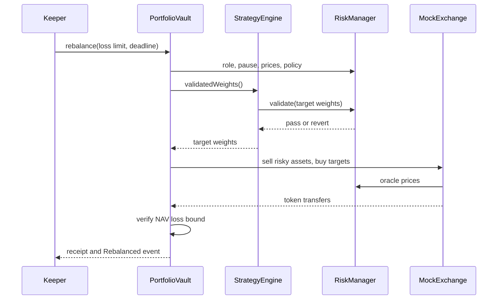

# Final report skeleton

**Title:** AlphaVault — Decentralized Quantitative Portfolio Management and Risk-Controlled Rebalancing Platform  
**Course:** SC6113  
**Author / student ID / submission date:** [complete from the official submission instructions]  
**Document status:** Working outline. Not a completed final report.

## Abstract

Draft: AlphaVault demonstrates a transparent portfolio-management workflow in which investors deposit test assets, a strategy manager selects an allocation rule, and an independent risk contract authorizes a Keeper's rebalance. The implementation combines three interacting Solidity contracts, a REST API, durable SQLite records and a wallet-capable dashboard. Three strategies and synthetic, cost-aware backtests illustrate quantitative system design. Local testing covers accounting, policy enforcement and failure handling. Public deployment and empirical market evaluation must be reported separately when completed.

Revise the abstract after public deployment; do not imply mock prices are live data or local receipts are Sepolia evidence.

## 1. Problem and motivation

- Treasury managers need observable holdings, reproducible allocations, clear authority and controlled execution.
- Explain why a blockchain adds verifiable custody rules and public execution history, while price reporting and Keeper availability remain off-chain dependencies.
- Define the single-person project scope and the distinction between this system and the earlier escrow assignment.
- State the research question: can a small DApp separate strategy discretion, risk authority and custody while making the resulting portfolio changes auditable?

## 2. Requirements and use cases

Insert `REQUIREMENTS.md` mapping after confirming the original rubric. Describe Investor deposit/redeem, Manager strategy change, Risk-officer policy adjustment, Keeper execution, Admin role control. Include misuse cases: unauthorized strategy changes, stale reports, excessive weights, paused deposits and double redemption.

## 3. System architecture

Use README's architecture diagram. Include a sequence diagram:

Explain REST reads, unsigned transaction construction, client wallet signing, database schemas and reorg handling. State that smart-contract access control is authoritative, not the dashboard role selector.

## 4. Contract and accounting design

Document units: 18-decimal mock tokens, basis-point weights, 24-decimal displayed shares. Derive NAV, deposit conversion and in-kind redemption using the consistent virtual-share denominator. Discuss minimum shares, reentrancy protection, immutable dependencies, deliberate residual virtual balances and external-token assumptions. Explain pause semantics and stale-price exit availability.

Present the 13-method transaction table. Do not count getters or failed preflight calls as chain transactions.

## 5. Quantitative strategy and execution methods

- Equal Weight: retain configured cash, split remaining exposure equally.
- Momentum: prior reported signal comparison; 75/25 risky tilt, or all cash if both signals are nonpositive.
- Volatility Target: reduce risky exposure using the mean asset-volatility estimate; explain why this is conservative and does not estimate covariance.
- Distinguish manually reported on-chain inputs from off-chain synthetic research signals.
- State 20-day lookback, 7-day rebalancing, daily prices, 365-day annualization, zero risk-free rate, 20 bp fees for both sell and buy legs, lagged information and omitted gas.
- Explain full-liquidation turnover and how a later incremental execution engine could reduce costs.

## 6. Evaluation

Use current `evidence/tests.tap`, `transactions.json` and `backtests.json`, quoting their generation date/compiler/source hashes. Report the actual test count and pass/fail status; do not copy stale counts into the final document.

Suggested tables: test categories, gas by business method, rejection cases, synthetic strategy return/volatility/drawdown/Sharpe/cost. Label synthetic outcomes prominently and include negative results. Add an empirical-data evaluation only after obtaining and documenting the dataset. Do not infer robust performance from the generated fixture.

Add browser acceptance evidence for deposit, strategy selection, rebalance, policy rejection, paused redemption and ledger. Record whether the signing path was local test accounts or a real wallet.

## 7. Deployment, limitations and discussion

Before final submission fill in the actual HTTPS URL, API endpoint, chain ID, contract addresses, source-verification links, testnet receipt hashes and database-restart check. Sepolia deployment and the three-wallet business demonstration are complete; public website/API hosting and source verification are pending. Use `SEPOLIA_RESULTS.md` for measured outcomes and `../evidence/sepolia-business-evidence.json` for the 12 receipts / 10-method coverage.

Discuss trusted oracle/admin, no production audit, limited mock venue liquidity, market drift after validation, stale inputs, in-kind exit exposure, virtual-balance residuals, simplified Keeper operation, SQLite single-instance deployment, one-block observations vs finality, and no live profitability conclusion.

## 8. Conclusion and future work

Summarize demonstrated system behavior with evidence. Prioritize public acceptance first, then independent oracle integration, empirical cost-sensitive research, multisig role administration, incremental routing and external security review.

## References and appendix

- Solidity documentation: security considerations and checks-effects-interactions.
- OpenZeppelin documentation: ERC-4626 inflation attack / virtual-share discussion; explicitly state this is not an ERC-4626 implementation.
- ethers, SQLite and Ganache documentation, with versions.
- Original course brief when obtained.
- Appendix: commands, role matrix, complete receipt inventory, API examples, database schema and code availability.
