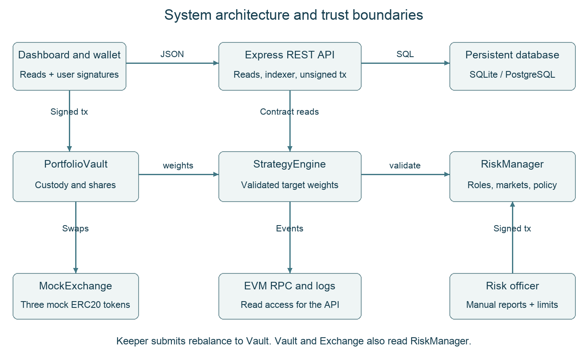
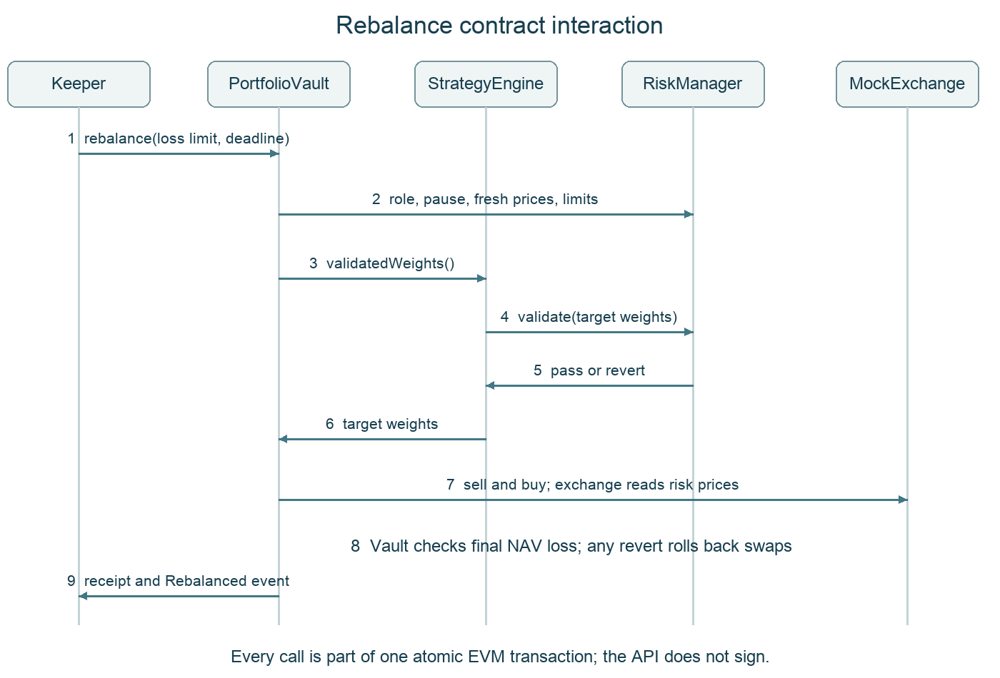
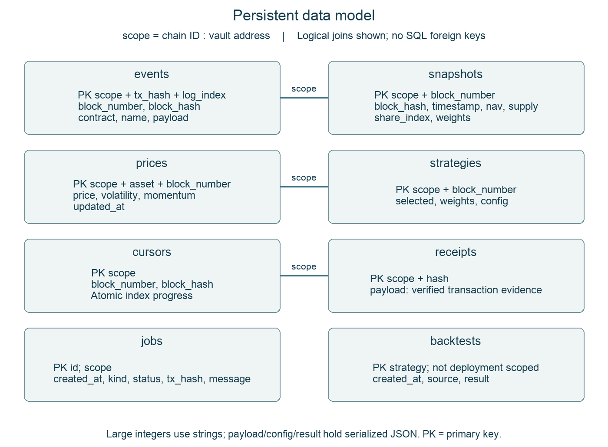
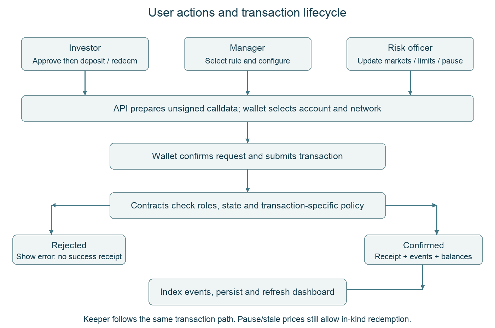
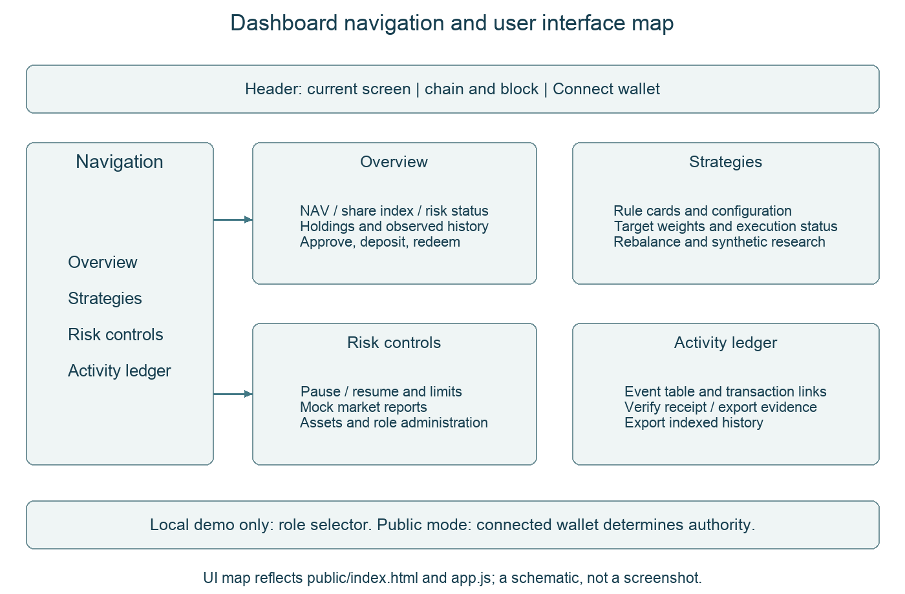

# AlphaVault technical report

Decentralized Quantitative Portfolio Management and Risk Controlled Rebalancing Platform

SC6113 DApp project • Submission report • Evidence checkpoint 18 October 2026

Author: Du zhuotong

## Abstract

AlphaVault implements a portfolio-management workflow in which investors deposit mock cash, a manager selects an allocation rule, and a separate risk officer sets trading constraints. A Keeper triggers a transaction that calculates and validates target weights before moving tokens. The three core Solidity contracts separate custody, strategy selection and risk policy. An Express REST API indexes chain events into SQLite locally or PostgreSQL in the hosted deployment, while a wallet-connected dashboard displays portfolio state and transaction evidence.

The implementation is deployed on Sepolia and the dashboard is publicly accessible over HTTPS. Saved evidence records 12 successful public business transactions across 10 method types, including ERC20 approval, and a hosted database sentinel that survived a service restart. The public rebalance and paused redemption demonstrate token movements and an exit path under a trading pause. The strategy study uses deterministic synthetic prices. It evaluates implementation behavior and trading costs, without establishing investment profitability.

## Project scope and acceptance criteria

| Criterion supplied for this project | Implementation and evidence |
| --- | --- |
| Individual project | Separate AlphaVault source tree. Earlier escrow projects remain unchanged. Du zhuotong is the named project owner. |
| At least three roles and interacting contracts | Investor, manager and risk officer use separate wallets. Keeper/admin roles also exist. Vault calls StrategyEngine and RiskManager. |
| At least ten transaction types | 13 supported methods demonstrated locally. Sepolia has 10 types including approve, or 9 core methods. |
| REST API and persistent database | Same-origin JSON endpoints and a persistent event/receipt store. Hosted PostgreSQL restart acceptance passed. |
| Public deployment and materials | Sepolia contracts plus Render HTTPS application. This 14-page report, slides, ten-minute video, user manual and individual contribution report accompany the source archive. |

Public application: https://alphavault-sepolia.onrender.com
Repository: https://github.com/qwekker/alphavault-sc6113 (private at this checkpoint). This report follows the six submission categories supplied for this project; the original course handout was not provided. [1, 5]

---

## Real world problem and stakeholders

The target setting is a small token treasury whose contributors want delegated portfolio management without giving the strategy operator unrestricted custody. A spreadsheet can describe desired weights, but cannot itself prevent an operator from exceeding those weights during a transfer. A single signing account can execute changes quickly, but combines strategy, risk approval and custody authority. AlphaVault investigates whether an inspectable contract workflow can separate these responsibilities while keeping an investor exit available during a trading pause.

This is a design scenario, not a claim that a particular organization was interviewed. No user survey or field adoption study was conducted. The practical questions are who can change policy, how a reviewer can reconstruct an allocation, and whether execution obeys that policy when a user bypasses the interface. Blockchain provides shared execution records and programmable checks; it also introduces fees, key-management duties and dependencies on external prices. Ethereum’s oracle documentation explains why external data needs a separate input mechanism. [10]

| Stakeholder | Need and incentive | Conflict or exposure |
| --- | --- | --- |
| Investor / treasury contributor | Traceable holdings and proportionate exit | Manager discretion versus capital protection; token and oracle risk |
| Strategy manager | Change allocation rules and parameters | Return seeking may conflict with position or volatility caps |
| Risk officer | Enforce exposure policy and respond to incidents | Pause protects trading but may frustrate the manager; manual prices are trusted |
| Keeper / operator | Reliable eligible execution and observable jobs | Availability and gas costs; cannot change policy to force execution |
| Admin and reviewer | Manage access; reproduce results and inspect history | Admin remains powerful; private repository access must be arranged |

Acceptance focuses on observable behavior: unauthorized actions are rejected; valid allocation changes move actual test tokens; blocked trading does not remove in-kind exit; and records survive restart. The broader benefit of lower operating effort is a hypothesis for later user testing. A centralized service with standard approval controls is a valid alternative when participants do not need public verification or cannot manage wallets.

---

## System architecture diagram

The browser reads the same-origin API and requests unsigned calldata. In public mode, MetaMask signs the transaction and the network enforces the sender identity. The server reads through an EVM RPC provider, indexes logs and maintains an observational database; it has no public signing key. Local mode additionally provides disposable test signers for demonstrations. The database is not the authoritative source of token balances.

PortfolioVault holds the assets. StrategyEngine supplies target weights, and RiskManager validates policy and provides market reports. MockExchange prices mock token swaps using those reports. The Keeper is an off-chain process that can request a rebalance; it cannot bypass the vault checks. “Automatic” therefore requires a running authorized process and valid inputs. The public deployment demonstrates manually signed Keeper execution, not a permanently running cloud signer.

The three core contracts separate responsibilities, but they do not remove all trust: the admin can assign roles and the risk officer supplies prices. This architecture is suitable for evaluating access control and execution flow with test assets. Independent oracle feeds, stronger administration and security review remain future work. [2, 3, 10, 11]

---

## System design and authority

Custody and authorization remain on chain. The browser obtains an unsigned transaction from the API and asks MetaMask to sign it on the configured network. Role labels in the interface help the user choose an account, but the contracts enforce permission checks. The public backend contains no signing wallet and rejects local demo signing. This keeps the hosted service responsible for reads, indexing and transaction preparation rather than custody. [2, 3]

| Component | Responsibility | Calls or dependency |
| --- | --- | --- |
| PortfolioVault | Custodies mUSD, mETH and mBTC. Issues nontransferable shares and executes rebalance or in-kind redemption. | StrategyEngine, RiskManager, MockExchange |
| StrategyEngine | Stores the selected rule, cash buffer, volatility target, cooldown and enabled flags. | RiskManager role checks and validate |
| RiskManager | Stores roles, manually reported markets, trading limits and pause state. | Known mock token addresses |
| MockExchange | Exchanges mock assets using reported prices and a fixed 20 basis point fee. | RiskManager and ERC20 tokens |

## Roles and separation of duties

| Role | Permitted actions | Wallet assignment |
| --- | --- | --- |
| Investor | Approve, deposit and redeem own shares | A |
| Manager | Select/configure/enable strategy and toggle automation | B |
| Risk officer | Report markets, enable assets, set limits, pause/resume | C |
| Keeper | Submit an eligible rebalance | A |
| Admin | Grant or revoke operational roles | A |

A is the investor/admin/Keeper account. B is the manager and C is the risk officer. These are three distinct wallets, not five distinct people. The admin can reassign roles, so governance still trusts a central administrator. The deployment procedure revokes the deployer’s temporary risk role after initialization. Full addresses appear in the evidence appendix. [4]

## Rebalance transaction sequence

The Keeper calls PortfolioVault.rebalance with a loss bound and deadline. The vault checks Keeper permission, automation, the deadline and cooldown. StrategyEngine computes weights and calls RiskManager.validate. The vault values its holdings, sells existing risky assets into mUSD, then buys risky assets according to the target. Each swap has an output floor, and a final NAV-loss check bounds aggregate execution loss. Any revert rolls back token transfers and the rebalance timestamp. Events expose the executed strategy and before/after values. [2]

---

## Smart contract interaction diagram

Each arrow represents an external call or return within the same transaction, apart from the final receipt observation. The vault checks the sender and execution conditions, obtains validated weights, sells existing risky holdings to cash and buys the target risky exposure. The exchange reads the risk contract for mock prices. Caller bounds and the final aggregate loss check prevent excessive execution loss under the reported prices.

A failure reverts the entire transaction, including token movements and the rebalance timestamp. A browser estimation failure has no mined receipt; it is not counted as a successful transaction. Contract tests deliberately exercise loss-bound rollback, cooldown, deadline and role rejection. The real-chain demonstration provides a successful Sepolia rebalance receipt with 563,260 gas. [2, 4, 7]

---

## Accounting and risk controls

## Deposits and share accounting

All three mock tokens use 18 decimal places. The dashboard scales raw vault share units by 10 to the power 24 when displaying balances. A deposit mints shares by multiplying the raw cash deposit by total raw share supply plus 1,000,000, then dividing by current raw NAV plus 1. Integer division rounds down, and minShares protects the investor against receiving fewer shares than accepted. NAV includes the value of any assets directly donated to the vault. The virtual balances reduce the empty-vault donation/rounding attack surface. [2]

Redemption burns the caller’s shares and transfers a proportional basket. For each asset, the amount is its raw vault balance multiplied by redeemed raw shares, divided by total raw supply plus 1,000,000. The cash numerator also includes one virtual raw unit. Entry and exit therefore use consistent virtual supply. Each asset has a caller-specified minimum amount. Very small residual balances can remain due to virtual balances and rounding. This simplified basket interface is not ERC-4626, and shares are not transferable. [2]

## Policy enforcement

| Control | Enforcement and practical implication |
| --- | --- |
| Position and cash limits | Target risky-asset weights must respect the cap and total cash must meet the floor. These tests constrain targets rather than continuously rebalancing market drift. |
| Volatility bound | RiskManager sums weight times reported volatility for risky assets. This proxy has no covariance estimate and depends on trusted reports. |
| Freshness and asset status | Stale prices block required valuation and trading. Positive risky target exposure requires an enabled asset. A market update does not implicitly re-enable it. |
| Execution bounds | Deadline, cooldown, per-swap output floors and a final NAV-loss check constrain execution. Caller loss tolerance cannot exceed policy. |
| Emergency pause | Pause blocks deposits and rebalancing. Redemption remains available using balances and shares, without needing fresh prices. |

The API may display a valuation based on the latest observed prices after those reports expire, but it marks that valuation stale. Such a display is not proof that a new deposit or rebalance can execute. Paused redemption is intentionally independent of fresh oracle reports because it transfers the held basket instead of promising a cash value. [2, 3]

## Security boundaries

The vault uses a reentrancy lock and updates share balances before external token transfers. Tests cover role violations, rollback, min-output bounds and donation rounding. The system assumes its own standard mock tokens and a controlled exchange. It has no independent audit, formal verification or evidence of compatibility with arbitrary fee-on-transfer or malicious tokens. A compromised risk officer can supply misleading prices, and a compromised admin can reassign authority. These assumptions limit the deployment to a course demonstration.

---

## Data model diagram

The scope value is derived from chain ID and vault address, preventing records from different deployments from being mixed. Composite primary keys deduplicate events and per-block observations. The diagram shows logical links, not foreign-key constraints: the implementation does not declare SQL foreign keys. Backtests are keyed by strategy and identify their synthetic data source separately.

Amounts that can exceed JavaScript integer precision are stored as strings. JSON payloads preserve event arguments, strategy configuration and evidence. The indexer commits each batch with its cursor; it compares the stored block hash to detect chain rollback. A reorganization triggers a scoped rebuild. Retention of 2,000 snapshot blocks limits telemetry growth while retaining the event and receipt records. [3]

---

## Process flow and failure handling

An investor must approve the mUSD allowance before depositing. The vault converts the deposit to shares using pre-deposit NAV and a minimum-share bound. Strategy selection changes the allocation rule but does not itself trade. A separate eligible Keeper request performs rebalancing. The dashboard refreshes after confirmation and periodically thereafter; a displayed pending message is not proof that a transaction succeeded.

The risk officer can pause trading or change market reports and limits. A pause prevents deposits and rebalance execution, while redemption transfers the held basket without requiring fresh market prices. Under a stale-price warning, a historical valuation may remain visible, but that valuation is not an assurance that a new trade can execute. Wallet rejection or failed estimation should be resolved before retrying; an uncertain broadcast must be checked by transaction hash. [2, 3]

---

## User interface diagram

Overview makes the environment and portfolio state visible before a capital action. Strategies separates rule selection from execution and clearly labels synthetic research. Risk controls groups emergency and policy actions. Activity ledger connects user operations to event records and verified transaction evidence. The local role selector is absent from public mode; switching a label cannot grant on-chain authority.

The diagram is a schematic derived from the implemented HTML and JavaScript. The accompanying video shows the actual application. The user manual provides click sequences, expected outcomes and troubleshooting. In the hosted demo, each operator connects the appropriate Sepolia wallet. The public page can be inspected without a wallet, but signing requires account access. [3, 4]

---

## Quantitative methods and evaluation

The allocation rules use integer basis points, where 10,000 means 100 percent. Equal Weight retains the cash buffer and splits remaining exposure between mETH and mBTC. Momentum allocates 75 percent of risky exposure to the asset with the higher reported momentum and 25 percent to the other. If both signals are nonpositive, it holds all cash. Ties favor mETH. Volatility Target scales total risky exposure down when its mean-volatility proxy exceeds the target, then splits that exposure equally. [2, 6]

The default cash buffer is 20 percent and the volatility target is 12 percent. The volatility rule uses the arithmetic mean of the two reported volatilities, not a covariance matrix. The risk contract applies its weighted-volatility policy separately. The backtester mirrors allocation and full sell-then-buy execution, but does not replay every contract role, freshness or policy check. It is a strategy-method experiment rather than a full EVM execution simulator. [6]

## Reproducible synthetic experiment

The saved experiment starts with 10,000 synthetic cash units and uses a deterministic 181-day price fixture. A 20-day lookback leaves 160 return intervals for evaluation. Signals for trading on day t use observations only through day t minus 1. Rebalancing occurs every seven days after warm-up, with a 20 basis point fee on each sell and buy leg. Network gas, market impact and independent market data are absent. The strategy signal uses log-return sample volatility, while reported portfolio volatility uses daily NAV simple returns. Both annualize with 365 days. Sharpe assumes a zero risk-free rate. [6]

| Strategy | Total return | Ann vol | Max drawdown | Sharpe |
| --- | --- | --- | --- | --- |
| Equal Weight | -2.32% | 13.36% | 9.04% | -0.33 |
| Momentum | -22.59% | 11.95% | 24.93% | -4.83 |
| Volatility Target | -1.58% | 8.49% | 5.82% | -0.39 |

All three strategies lose value on this fixture after fees. Volatility Target has the smallest drawdown (5.82 percent) and lowest observed annualized volatility (8.49 percent), but its total return is still negative at 1.58 percent. Momentum loses 22.59 percent and has a 24.93 percent maximum drawdown. This result does not support a profitability claim or a general ranking across real markets.

Cumulative simulated transaction costs are 674.45 units for Equal Weight, 430.12 for Momentum and 431.50 for Volatility Target. Selling all risky holdings before each rebalance creates avoidable turnover, even when target weights change little. A next research version should use net trades, a cash/buy-and-hold benchmark, real out-of-sample data, parameter sensitivity and realistic liquidity costs. The saved fixture alone cannot establish alpha. [6]

---

## Testing and Sepolia results

The pre-deployment full suite passed 64 tests. After the Supabase CA change, the seven PostgreSQL tests passed again. Contract tests cover separation of roles, strategy weights, bounded trades, cooldown/deadline checks, partial redemption, pause/staleness behavior, and donation rounding. API tests cover unsigned calldata, deployment binding, persistence, reorg handling and receipt validation. PostgreSQL unit tests execute SQL with PGlite; separate cloud acceptance confirms the real pg driver and TLS connection. A complete rerun on 18 October 2026 passed all 64 tests with zero failures; see evidence/submission-tests.tap. These are verified checkpoints rather than a claim of exhaustive coverage. [7, 8]

## Public business workflow

| Step | Observed outcome |
| --- | --- |
| Approve and deposit | Investor deposits 1,000 mUSD and receives 1,000 displayed shares. |
| Configure strategy and policy | Momentum target is 20/60/20 cash/mETH/mBTC. Cooldown is 120 seconds. Risk cap is 65 percent per risky asset, cash floor 15 percent, volatility bound 35 percent and loss bound 1 percent. |
| Rebalance | NAV falls from 1,000 to approximately 998.40 mUSD. The 1.60 reduction reflects mock fees and negligible rounding. Gas is paid separately in Sepolia ETH. |
| Pause and redeem | Investor redeems 250 shares while paused and receives 50 mUSD, about 0.0499 mETH and 0.0008316667 mBTC. |
| Resume | Investor retains 750 shares. Vault NAV is approximately 748.80 mUSD and share-value index is 99.84. |

The 250-share redemption removes roughly one quarter of both shares and the basket. The drop from 998.40 to 748.80 is a withdrawal, not a trading loss. The public rebalance used 563,260 gas and cost 0.000844894192907440 Sepolia ETH. Gas costs vary with transaction and network conditions. [4]

## Transaction coverage and limits of the evidence

The exporter revalidated 12 successful receipts covering 10 method types with no exclusions. The types are approve, deposit, selectStrategy, configure, setAutomation, updateMarket, setLimits, rebalance, setPaused and redeem. Repeated reports and pause/resume each count once. Deployments, minting and failed attempts are excluded. The ten types include ERC20 approve, leaving nine core-contract methods. If the rubric excludes approval, a further core method such as setEnabled needs a public demonstration. [4]

An unattended Keeper executed locally. The Sepolia rebalance was manually signed by the Keeper account, and no continuously running cloud signing worker is claimed. Public pause/redemption receipts prove a successful exit while paused. Paused-deposit and unauthorized-action rejections were tested locally, without sending deliberate failing public transactions. Canonical receipts at an observation time do not guarantee finality. [4, 7]

---

## Measurable impact evaluation

The evaluation separates implementation effects from real-world adoption. The functional question is whether the stated controls and exit path work in the tested scenarios. The research question is how a volatility-target rule compares with Equal Weight on the same deterministic fixture. No randomized user study, live capital deployment or operational time-saving study was conducted. The figures below are observed prototype outcomes, not estimates of production benefit.

| Question / baseline | Measured outcome | Interpretation and limit |
| --- | --- | --- |
| Policy boundary: unauthorized requests | Six privileged calls rejected across investor, manager and revoked-Keeper scenarios | 6/6 scripted calls rejected; not a probability of resisting arbitrary attacks |
| Exit during trading pause | One public 250-share redemption succeeded while paused; local deposit/trade rejection tests passed | Demonstrates the intended basket exit; not a promise of cash liquidity |
| Volatility Target vs Equal Weight | Maximum drawdown 5.82% vs 9.04%; difference 3.22 percentage points | About 35.6% smaller drawdown on this fixture only |
| Same fixture and fee assumptions | Annual volatility 8.49% vs 13.36%; return -1.58% vs -2.32% | Volatility lower by 4.87 pp; return higher by 0.74 pp, both still negative |
| Execution cost at public rebalance | 1.60 mUSD reduction from 1,000 = 0.16%; 563,260 gas | Mock fee result and separate network cost, not live DEX slippage |
| Persistence before/after one restart | The same non-chain jobs sentinel retained | One observed restart retained data; does not establish an uptime SLA |

The six rejection calls correspond to four investor attempts, one manager attempt and one revoked-Keeper attempt in contracts.test.mjs. The latest complete test run is recorded in submission-tests.tap. The drawdown and volatility differences are calculated from full-precision backtests.json values, with Equal Weight as an explicit baseline. These results support the narrow claim that the prototype can constrain tested actions and that its conservative rule reduced variability on this fixture. They do not establish alpha, general market robustness or reduced staffing cost. [4, 6, 7, 8]

A future impact study should preregister a representative task set, compare completion time and error rate against an approval-based spreadsheet workflow, and test real out-of-sample market periods with gas and liquidity costs. Until such data exists, usability and organizational savings remain unmeasured.

---

## REST service and durable hosting

The hosted system uses a Node.js 22 Docker container on Render Free and external Supabase PostgreSQL in Singapore. The dashboard and REST service share an origin. The deployed code checkpoint is 52aca85. Its public health endpoint reports wallet mode, chain ID 11155111 and PostgreSQL, and checks database and RPC connectivity. No signing key is stored in the application. The DATABASE_URL remains a Render secret. [3, 8]

| API group | Selected routes | Purpose |
| --- | --- | --- |
| State | GET /api/portfolio, /api/prices, /api/strategies | Block-tagged holdings, freshness, targets and risk state |
| Evidence | GET /api/history, /api/evidence; POST /api/receipts | Indexed events and RPC-verified successful transactions |
| Preparation | POST /api/transactions/build | Unsigned to/data/value/chainId for wallet signing |
| Research and operations | GET /api/backtests/:id, /api/jobs, /api/health | Persisted synthetic results and operational observations |

## Data model and recovery

Eight tables store events, snapshots, prices, strategies, jobs, backtests, cursors and receipts. Chain-derived records are scoped by chain ID and vault address. Events deduplicate by transaction hash and log index within that scope. Each indexing batch commits its records and cursor atomically. A canonical cursor hash mismatch causes a scope rebuild. Snapshot observations are not a complete historical NAV series, and rebuilding chain events does not recreate old observations that were never collected. [3]

The database retains the latest 2,000 snapshot blocks per deployment for portfolio, price and strategy telemetry. Events and receipt evidence remain retained. The API displays the latest 200 snapshots. PostgreSQL tables use a private alphavault schema with RLS enabled and no public policies. The server uses a database owner connection, so those controls do not remove the need to protect server credentials. TLS certificate verification remains enabled, using the bundled official Supabase root CA for recognized Supabase hosts. Missing required PostgreSQL configuration fails startup rather than silently using ephemeral SQLite. [3, 8]

## Hosted acceptance and operating limits

Both saved public acceptance runs passed. First startup imported 12 verified receipt hashes. Following a service restart, startup imported zero and skipped the same 12. To distinguish persistence from reconstruction using chain data, the acceptance procedure inserted a non-chain jobs sentinel through the SQL editor. Its row and message remained identical after restart. The combined evidence therefore supports hosted database persistence across that restart. [8]

A new public API acceptance run on 18 October 2026 again passed wallet-mode, PostgreSQL, deployment binding and receipt checks; it did not repeat the earlier restart experiment. The browser check verified a public dashboard with Momentum, NAV 748.80 and stale-price disclosure. It did not send a new wallet transaction from the public origin. Free compute sleeps when idle and an inactive database may pause. Price reports expire after one hour. Continuous availability, current tradability and unattended cloud rebalancing are not established by the recorded deployment checkpoint. [8]

---

## Evidence appendix and submission preparation

## Deployment and account identifiers

Network: Ethereum Sepolia, chain ID 11155111. Compiler: Solidity 0.8.30, optimizer enabled with 200 runs, Shanghai EVM target. The project deploys three core contracts, one mock exchange and three mock tokens. Runtime wiring and receipts were verified separately from explorer source-code verification, which remains pending. [4, 9]

PortfolioVault: 0x4076F1c885eF0f0651005e862D3264D538C941C9

StrategyEngine: 0x548055cd0103CAA87FAD3a4e329f4c5Dfbd14bFe

RiskManager: 0xe526418735631F067ea62eC84A7c3A383C37AcaE

A investor admin Keeper: 0x0258E85f725F2d17f87f0f25984A7FD503448169

B manager: 0xF72d3B36594dA7b06E3994112C8B1516e57cB3aA

C risk officer: 0xF540005bC24b6E39A6abD22923BC9a7550C94252

## Evidence references

[1] docs/REQUIREMENTS.md. User-supplied constraints and inventory of earlier projects.

[2] contracts/PortfolioVault.sol, StrategyEngine.sol, RiskManager.sol and MockExchange.sol. Authoritative implementation.

[3] docs/API.md; server/service.mjs, actions.mjs, store.mjs and postgres-store.mjs. API, indexer and storage behavior.

[4] docs/SEPOLIA_RESULTS.md; evidence/sepolia-business-evidence.json, sepolia-final-portfolio.json and sepolia-verification.json. Public receipts and deployment observations, 17 October 2026.

[5] Public dashboard https://alphavault-sepolia.onrender.com and health route /api/health. Hosted acceptance checkpoint 18 October 2026 Singapore time.

[6] server/quant.mjs and evidence/backtests.json. Deterministic synthetic experiment, 160 daily intervals after warm-up.

[7] evidence/submission-tests.tap (latest 64/64); free-hosting-tests.tap and postgres-tests.tap (earlier checkpoints); test/*.test.mjs.

[8] evidence/submission-hosted-check.json (latest API); hosted-acceptance.json and hosted-jobs-before-restart.json / hosted-jobs-after-restart.json (restart proof).

[9] scripts/compile.mjs and public deployment manifest in config/. Compiler configuration and deployed addresses.

[10] Ethereum documentation. Oracles. https://ethereum.org/developers/docs/oracles/ (accessed 18 October 2026). External inputs and trust boundaries.

[11] Ethereum documentation. Smart contract security. https://ethereum.org/developers/docs/smart-contracts/security/ (accessed 18 October 2026). Security review context.

## Submission and operational notes

The report has 14 pages and the demonstration runs for ten minutes. Confirm marker access to the private repository or submit the source archive. Explorer source verification remains pending if separately required. Before a live trading demonstration, the risk officer must refresh both mock market reports. If approval does not count toward transaction types, record one additional core method. The accompanying video separates local actions from public historical evidence. No audit or real-market return claim is included.
